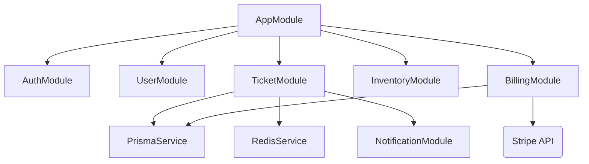

# NestJS Backend Architecture & System Design
## TrustZone Mobile Care — Enterprise Platform Backend Layer

---

## 1. Directory & Folder Structure

This backend utilizes a highly modular NestJS design, keeping modules self-contained to enable seamless transition to microservices.

```
trustzone-backend/
├── prisma/
│   ├── schema.prisma             # Core database schemas
│   └── migrations/               # PostgreSQL schema migrations
├── src/
│   ├── common/                   # Shared utilities, filters, decorators, and guards
│   │   ├── decorators/           # Custom decorators (e.g., @CurrentUser, @Roles)
│   │   ├── exceptions/           # Custom exception classes and global filter
│   │   ├── guards/               # JWT, RBAC, and Throttler guards
│   │   ├── interceptors/         # Serialization, Cache, and Logging interceptors
│   │   ├── middleware/           # HTTP Request tracking & context middleware
│   │   └── pipes/                # DTO Validation and custom transformation pipes
│   ├── config/                   # Configuration loader (App, Database, Redis, JWT)
│   ├── modules/                  # Feature Modules
│   │   ├── auth/                 # Auth controller, JWT/Refresh strategies, Redis session checks
│   │   ├── users/                # User CRUD and permissions
│   │   ├── tickets/              # Ticket lifecycle operations
│   │   ├── inventory/            # Parts catalog, multi-branch stock levels
│   │   ├── billing/              # Invoice generators, payment processor bindings (Stripe)
│   │   ├── notifications/        # Event-driven SMS/Email dispatcher
│   │   └── ai/                   # AI triage, technician diagnostics support
│   ├── health/                   # Liveness/Readiness endpoints (Terminus)
│   ├── app.module.ts             # Root application module assembling imports
│   └── main.ts                   # Bootstrapping script (CORS, Swagger, Global Pipes)
├── test/                         # E2E test suites
├── Dockerfile                    # Multi-stage production container definition
└── docker-compose.yml            # Local developer services infrastructure (Postgres, Redis)
```

---

## 2. API Design & Endpoint Structure

API routes are grouped logically by module context, utilizing semantic HTTP verbs and versioning prefixes:

### 2.1 Public Gateway (`/api/v1/...`)
*   `POST /api/v1/auth/login` - Authenticates user; issues access JWT and sets secure HttpOnly cookie for Refresh JWT.
*   `POST /api/v1/auth/refresh` - Validates Refresh JWT; generates new Access JWT.
*   `POST /api/v1/auth/logout` - Blacklists current access token in Redis.
*   `GET /api/v1/estimates` - Public estimate calculator matching issue types against prices.
*   `POST /api/v1/tickets/book` - Anonymous booking wizard, auto-creates customer accounts.

### 2.2 Customer Dashboard Panel (`/api/v1/customer/...`)
*   `GET /api/v1/customer/tickets` - Lists all tickets belonging to the authenticated customer.
*   `GET /api/v1/customer/tickets/:id` - Detailed diagnostic status, updates, and evidence log.
*   `POST /api/v1/customer/tickets/:id/approve` - Authorizes estimate charges, changing ticket state to 'approved'.
*   `POST /api/v1/customer/payments/pay` - Initiates payment gateway token validation for active invoices.

### 2.3 Technician Workspace (`/api/v1/tech/...`)
*   `GET /api/v1/tech/tickets` - View prioritized queue of assigned repair tasks.
*   `PATCH /api/v1/tech/tickets/:id/status` - Move ticket state (e.g., 'diagnosing' -> 'repairing') with QA check off metadata.
*   `POST /api/v1/tech/tickets/:id/parts` - Submit inventory parts allocation requests.

### 2.4 Manager & Admin Control Panel (`/api/v1/admin/...`)
*   `GET /api/v1/admin/analytics/revenue` - Consolidated financial reports across branches.
*   `GET /api/v1/admin/inventory/low-stock` - Flag items falling below min threshold limits.
*   `POST /api/v1/admin/inventory/replenish` - Trigger PO requests and log incoming inventory stock.

---

## 3. Core Modules, Controllers, and Services

NestJS encapsulates application logic inside self-contained modules. Below is the functional structure:



### 3.1 `AuthModule`
*   **Controller:** Exposes login, registration, password resets, and session refreshes.
*   **Service:** Manages bcrypt hashing, cryptographically signs JWT payloads (Access TTL: 15m, Refresh TTL: 7d), and writes revoked access tokens to Redis with TTLs matching remaining token lifetimes.
*   **Guards:**
    *   `JwtAuthGuard`: Decodes Access Token header.
    *   `RolesGuard`: Inspects current context metadata to match against user roles (RBAC).

### 3.2 `TicketModule`
*   **Controller:** Serves customer booking inputs and technician updates.
*   **Service:** Coordinates database transitions. Moving a ticket status to 'Ready' updates database records, triggers the `BillingModule` to compile invoices, and publishes a `TicketReady` message to the event-bus (handled by `NotificationModule` asynchronously).

### 3.3 `InventoryModule`
*   **Controller:** Exposes actions for stock updates, catalog searches, and multi-branch stock transfers.
*   **Service:** Leverages Prisma transactions to adjust branch inventory quantities safely. Utilizes optimistic lock constraints to prevent concurrent stock reservation errors on the same parts SKU.

---

## 4. System Cross-Cutting Concerns

### 4.1 Input Validation & Transformation
NestJS validation utilizes global execution of class-validator and class-transformer:
*   **Payload Validation:** Incoming request bodies are mapped to Data Transfer Objects (DTOs) marked with validation decorators (e.g., `@IsEmail()`, `@IsUUID()`, `@Min(0)`).
*   **Stripping Unknowns:** The global pipeline strips out fields that are not defined in the DTO, protecting against malicious database updates.

### 4.2 Global Error Handling (Filter Pattern)
The global `HttpExceptionFilter` intercepts all thrown errors, transforming them into a structured API response format:
```json
{
  "statusCode": 400,
  "timestamp": "2026-07-08T11:32:00Z",
  "path": "/api/v1/tickets/book",
  "error": "Bad Request",
  "message": [
    "phone must be a valid phone number",
    "imei must match imei_format constraints"
  ]
}
```

### 4.3 Caching & Performance Architecture
*   **Redis Caching:** Leverages Cache Interceptors. Shared database views (such as model compatibility lists, public price estimates, and general branch metadata) are stored in Redis.
*   **Invalidation (Cache-Busting):** Inventory modifications trigger targeted cache eviction policies (`inventory:branch:*`) to maintain live stock accuracy across dashboards.

### 4.4 Rate Limiting & API Shielding
*   **Throttling:** Integrated `@nestjs/throttler` backed by Redis storage.
*   **Limits:**
    *   Public Estimate Calculator: `20 requests / min` per IP.
    *   Auth login attempts: `5 requests / min` per IP (exceeding triggers temporary block).
    *   General authenticated API paths: `120 requests / min`.

### 4.5 Structured Logging
*   **Logger Implementation:** Incorporate Winston into NestJS logger provider.
*   **Log Levels:** Debug logs stream to standard output locally. In production, structured JSON logs stream to Cloudwatch / ELK stack for auditing:
    ```json
    {"level":"info","timestamp":"2026-07-08T11:32:00Z","context":"TicketService","message":"Ticket TZ-9921 changed status to Repairing","userId":"usr-8831"}
    ```

---

## 5. Containerization & Deployment Design

We construct a multi-stage production Docker image to minimize file sizes and improve runtime security:

```
Stage 1: Build (Base Image: node:20-alpine)
- Copy package.json & lock files
- Run npm ci (install all dependencies)
- Copy source files, run Prisma generate schema
- Run npm run build (compiles NestJS to dist/ folder)
- Prune dev dependencies

Stage 2: Production (Base Image: node:20-alpine)
- Copy only production node_modules from Stage 1
- Copy compiled dist/ folder and prisma folder
- Run under non-privileged 'node' system user
- Expose App Port (3000)
- Entrypoint: node dist/main.js
```
This container operates as an ephemeral task on AWS ECS Fargate or Kubernetes behind an Application Load Balancer (ALB) performing TLS termination.
