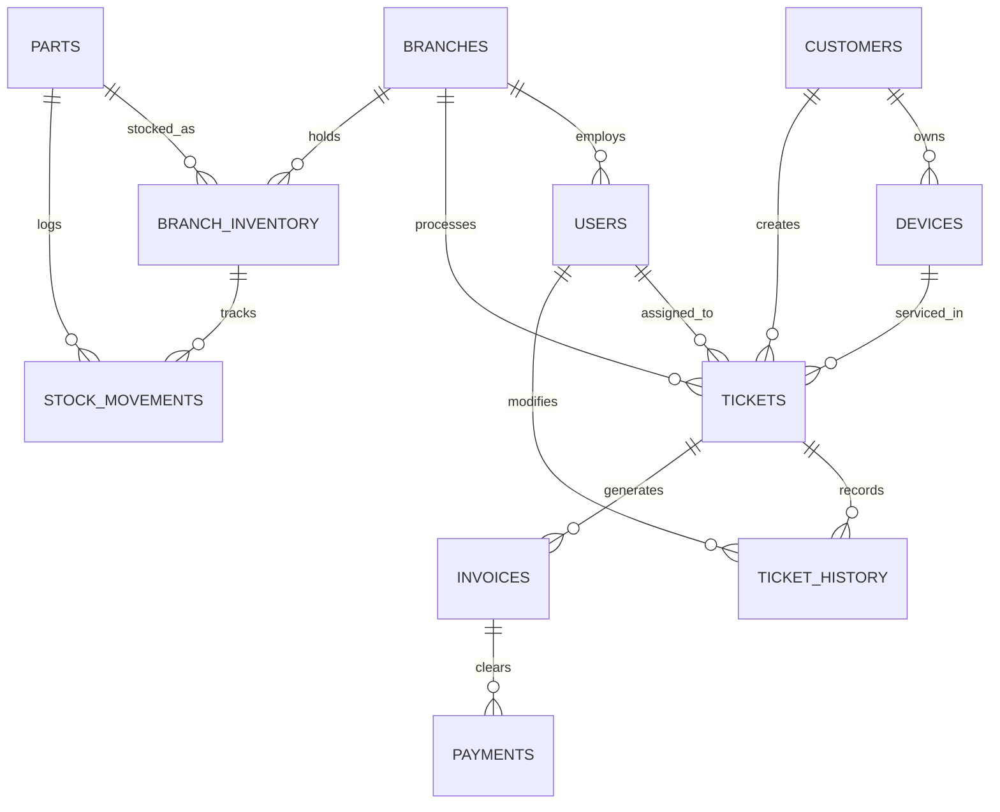
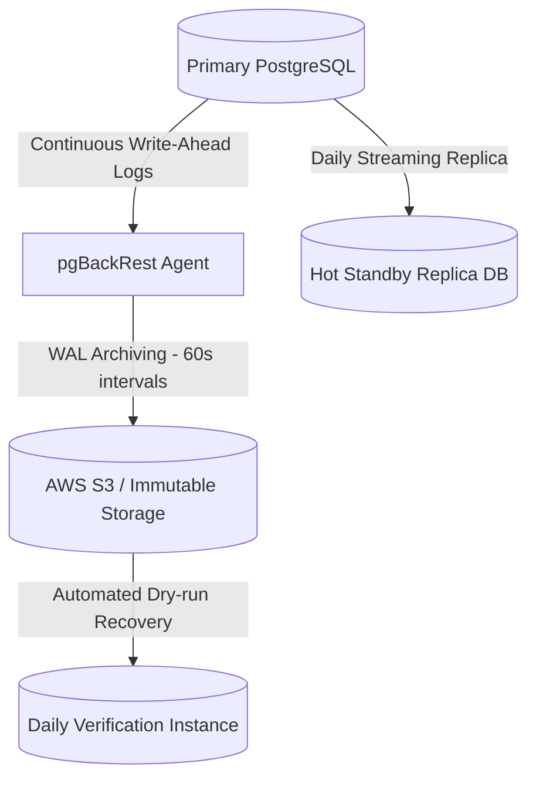

# PostgreSQL Database Architecture & Schema Specification
## TrustZone Mobile Care — Enterprise Platform Database Layer

---

## 1. Database Architecture & Design Philosophy

The database design uses PostgreSQL for data integrity, transaction safety, and scaling features. 

### 1.1 Key Architecture Decisions
*   **Primary Key Generation:** We use `UUIDv4` instead of auto-incrementing integers (`BIGSERIAL`). This prevents ID enumeration attacks, facilitates offline ID creation on mobile devices, and avoids ID collisions when merging multi-branch datasets.
*   **Multi-Tenancy Isolation:** Logical isolation is implemented using a shared-schema model. All branch-specific tables contain a `branch_id` column. We enforce isolation at the database level using PostgreSQL **Row-Level Security (RLS)**.
*   **Temporal Logging:** Every ticket transition and stock movement is recorded as an immutable ledger insert (append-only) to preserve history.

---

## 2. Entity-Relationship (ER) Diagram



---

## 3. Database Schema Definitions (Logical Representation)

### 3.1 Core Schema (`core`)

#### Table: `core.branches`
Represents physical shop locations and central warehouses.
*   `id`: `UUID` (PRIMARY KEY)
*   `name`: `VARCHAR(100)` (NOT NULL)
*   `address`: `TEXT` (NOT NULL)
*   `timezone`: `VARCHAR(50)` (NOT NULL - e.g., 'America/New_York')
*   `status`: `VARCHAR(20)` (NOT NULL - e.g., 'active', 'inactive')
*   `created_at`: `TIMESTAMPTZ` (NOT NULL, DEFAULT NOW())

#### Table: `core.customers`
*   `id`: `UUID` (PRIMARY KEY)
*   `first_name`: `VARCHAR(50)` (NOT NULL)
*   `last_name`: `VARCHAR(50)` (NOT NULL)
*   `email`: `VARCHAR(255)` (UNIQUE, NOT NULL)
*   `phone`: `VARCHAR(20)` (NOT NULL)
*   `loyalty_points`: `INTEGER` (NOT NULL, DEFAULT 0, CONSTRAINT points_non_negative CHECK (loyalty_points >= 0))
*   `created_at`: `TIMESTAMPTZ` (NOT NULL, DEFAULT NOW())

#### Table: `core.devices`
Tracks customer-owned hardware devices.
*   `id`: `UUID` (PRIMARY KEY)
*   `customer_id`: `UUID` (FOREIGN KEY -> `core.customers.id` ON DELETE RESTRICT)
*   `brand`: `VARCHAR(50)` (NOT NULL)
*   `model`: `VARCHAR(100)` (NOT NULL)
*   `serial_number`: `VARCHAR(100)` (NULLABLE)
*   `imei`: `CHAR(15)` (NULLABLE, CONSTRAINT imei_format CHECK (imei ~ '^[0-9]{15}$'))
*   `created_at`: `TIMESTAMPTZ` (NOT NULL, DEFAULT NOW())

#### Table: `core.tickets`
Manages repair lifecycle tickets.
*   `id`: `UUID` (PRIMARY KEY)
*   `branch_id`: `UUID` (FOREIGN KEY -> `core.branches.id`)
*   `customer_id`: `UUID` (FOREIGN KEY -> `core.customers.id`)
*   `device_id`: `UUID` (FOREIGN KEY -> `core.devices.id`)
*   `assigned_tech_id`: `UUID` (NULLABLE, FOREIGN KEY -> `system.users.id`)
*   `status`: `VARCHAR(30)` (NOT NULL, DEFAULT 'booked')
*   `estimated_cost`: `NUMERIC(10, 2)` (DEFAULT 0.00, CHECK (estimated_cost >= 0.00))
*   `sla_deadline`: `TIMESTAMPTZ` (NOT NULL)
*   `created_at`: `TIMESTAMPTZ` (NOT NULL, DEFAULT NOW())

#### Table: `core.ticket_history`
Append-only log tracking lifecycle modifications.
*   `id`: `UUID` (PRIMARY KEY)
*   `ticket_id`: `UUID` (FOREIGN KEY -> `core.tickets.id` ON DELETE CASCADE)
*   `old_status`: `VARCHAR(30)` (NOT NULL)
*   `new_status`: `VARCHAR(30)` (NOT NULL)
*   `updated_by`: `UUID` (FOREIGN KEY -> `system.users.id`)
*   `notes`: `TEXT` (NULLABLE)
*   `created_at`: `TIMESTAMPTZ` (NOT NULL, DEFAULT NOW())

---

### 3.2 Inventory Schema (`inventory`)

#### Table: `inventory.parts`
Global catalog of cataloged spare parts and accessories.
*   `id`: `UUID` (PRIMARY KEY)
*   `sku`: `VARCHAR(50)` (UNIQUE, NOT NULL)
*   `name`: `VARCHAR(150)` (NOT NULL)
*   `brand_compatibility`: `VARCHAR(50)` (NOT NULL)
*   `model_compatibility`: `VARCHAR(100)[]` (NOT NULL - array of compatible models)
*   `base_price`: `NUMERIC(10, 2)` (NOT NULL)
*   `minimum_stock_buffer`: `INTEGER` (NOT NULL, DEFAULT 5)

#### Table: `inventory.branch_inventory`
*   `branch_id`: `UUID` (FOREIGN KEY -> `core.branches.id`)
*   `part_id`: `UUID` (FOREIGN KEY -> `inventory.parts.id`)
*   `quantity`: `INTEGER` (NOT NULL, DEFAULT 0, CHECK (quantity >= 0))
*   `bin_location`: `VARCHAR(50)` (NULLABLE - e.g., 'Shelf B-3')
*   *PRIMARY KEY (`branch_id`, `part_id`)*

#### Table: `inventory.stock_movements`
*   `id`: `UUID` (PRIMARY KEY)
*   `branch_id`: `UUID` (FOREIGN KEY -> `core.branches.id`)
*   `part_id`: `UUID` (FOREIGN KEY -> `inventory.parts.id`)
*   `quantity_delta`: `INTEGER` (NOT NULL - e.g., -1 for consumption, +10 for replenishment)
*   `type`: `VARCHAR(30)` (NOT NULL - e.g., 'received', 'allocated', 'consumed', 'returned')
*   `reference_ticket_id`: `UUID` (NULLABLE, FOREIGN KEY -> `core.tickets.id`)
*   `created_at`: `TIMESTAMPTZ` (NOT NULL, DEFAULT NOW())

---

### 3.3 Billing Schema (`billing`)

#### Table: `billing.invoices`
*   `id`: `UUID` (PRIMARY KEY)
*   `ticket_id`: `UUID` (UNIQUE, FOREIGN KEY -> `core.tickets.id` ON DELETE RESTRICT)
*   `invoice_number`: `VARCHAR(50)` (UNIQUE, NOT NULL)
*   `subtotal`: `NUMERIC(10,2)` (NOT NULL)
*   `tax`: `NUMERIC(10,2)` (NOT NULL)
*   `total`: `NUMERIC(10,2)` (NOT NULL)
*   `status`: `VARCHAR(20)` (NOT NULL, DEFAULT 'unpaid')
*   `created_at`: `TIMESTAMPTZ` (NOT NULL, DEFAULT NOW())

#### Table: `billing.payments`
*   `id`: `UUID` (PRIMARY KEY)
*   `invoice_id`: `UUID` (FOREIGN KEY -> `billing.invoices.id`)
*   `amount`: `NUMERIC(10,2)` (NOT NULL, CHECK (amount > 0.00))
*   `payment_method`: `VARCHAR(30)` (NOT NULL - e.g., 'stripe', 'cash', 'terminal')
*   `transaction_reference`: `VARCHAR(100)` (NULLABLE - external gateway ID)
*   `status`: `VARCHAR(20)` (NOT NULL)
*   `created_at`: `TIMESTAMPTZ` (NOT NULL, DEFAULT NOW())

---

## 4. Indexing & Optimization Strategy

To maintain `< 50ms` response times for database queries, we establish a targeted indexing layout:

### 4.1 Specialized Indexes
1.  **Fast Search for Hardware (Device Lookup):**
    *   *Index:* B-Tree on `core.devices(imei)` and `core.devices(serial_number)`.
    *   *Purpose:* Allows instant lookup when scanning barcoded IMEIs at check-in.
2.  **Technician Workbench Queue Optimization:**
    *   *Index:* Composite index on `core.tickets(assigned_tech_id, status, created_at)`.
    *   *Purpose:* Removes sorting overhead when displaying active tasks to technicians.
3.  **Real-Time Stock Alerts:**
    *   *Index:* B-Tree index on `inventory.branch_inventory(branch_id, quantity)`.
    *   *Purpose:* Optimized for periodic cron jobs searching for inventory levels falling below buffer levels.
4.  **Audit Logs Filtering:**
    *   *Index:* BRIN (Block Range Index) on `core.ticket_history(created_at)`.
    *   *Purpose:* Space-efficient indexing for chronologically sorted log datasets.

---

## 5. Security & Isolation Model (RLS Example)

We restrict row visibility for technicians and branch managers to their active branch assignment.

```
Example RLS Filter:
CREATE POLICY branch_isolation_policy ON core.tickets
    FOR ALL
    USING (branch_id = NULLIF(current_setting('app.current_branch_id', true), '')::uuid);
```
When a query executes, PostgreSQL automatically filters returned rows to only include items matching the `app.current_branch_id` session variable, preventing accidental cross-branch data leaks.

---

## 6. Backup & Recovery Strategy

### 6.1 Recovery Objectives
*   **Recovery Point Objective (RPO):** `< 5 minutes` (maximum allowable data loss).
*   **Recovery Time Objective (RTO):** `< 1 hour` (maximum allowable recovery time).

### 6.2 Implementation Architecture


1.  **Continuous WAL Archiving:** Write-Ahead Logs (WAL) are streamed continuously and saved to external secure cloud storage every 60 seconds.
2.  **Daily Physical Backup:** A full physical backup is taken daily using `pgBackRest` or `WAL-G`, keeping a rolling 14-day history.
3.  **Active Replica Instance:** Run a read-only Hot Standby replica inside a separate availability zone for instant failover capability.
4.  **Backup Integrity Testing:** An automated script spins up a temporary PostgreSQL instance daily, restores the latest backup, and runs basic verification checks to ensure backup integrity.
