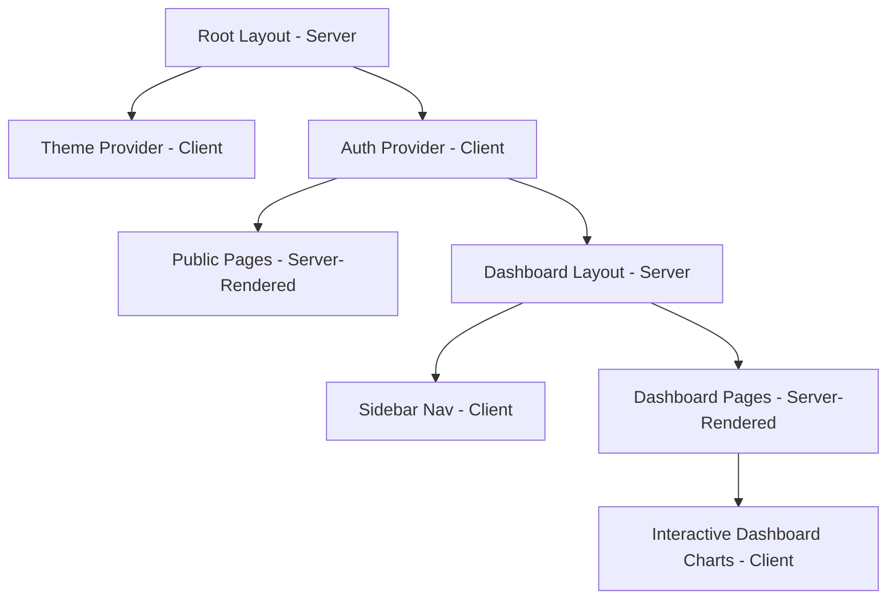

# Next.js Frontend Architecture & Design Specification
## TrustZone Mobile Care — Enterprise Platform Frontend Layer

---

## 1. Directory & Folder Structure

This application is built on Next.js using the **App Router** paradigm. It separates server-side layouts and pages from client-side interactive elements.

```
trustzone-frontend/
├── public/                       # Static assets (logos, icons, webp images)
├── src/
│   ├── app/                      # App Router Directory
│   │   ├── (auth)/               # Route Group: Auth views (login, register)
│   │   ├── (dashboard)/          # Route Group: Customer, Tech, Admin dashboards
│   │   │   ├── customer/
│   │   │   ├── tech/
│   │   │   └── admin/
│   │   ├── (public)/             # Route Group: Marketing website pages
│   │   │   ├── blog/             # ISR blog directory and post views
│   │   │   ├── booking/          # Interactive booking wizard flow
│   │   │   └── page.tsx          # Public high-conversion Landing Page
│   │   ├── layout.tsx            # Global layout (providers, font loaders)
│   │   └── providers.tsx         # Context providers wrapper (QueryClient, Auth, Theme)
│   ├── components/               # UI and Layout Components
│   │   ├── ui/                   # Shadcn UI base primitives (Radix)
│   │   ├── common/               # Shared custom blocks (Nav, Sidebar, Footer)
│   │   ├── dashboard/            # Specialized dashboard cards & tables
│   │   └── booking/              # Wizard flow step panels
│   ├── context/                  # Context APIs (AuthContext, BookingContext)
│   ├── hooks/                    # Reusable React hooks
│   ├── lib/                      # Client utilities (API fetcher, cn utility, SEO helper)
│   ├── styles/                   # Global Tailwind inputs
│   └── types/                    # Shared TypeScript interfaces
├── tailwind.config.ts            # Tailwind configuration & theme mapping
└── tsconfig.json                 # TypeScript compiler configurations
```

---

## 2. Component & Layout Architecture

The frontend uses **React Server Components (RSC)** by default to render data-heavy blocks on the server, selectively utilizing client components (`'use client'`) for user interactions.



### 2.1 Reusable Components Layout
*   **Shadcn Base Primitives:** Buttons, Input fields, Badges, Alert Dialogs, Accordions, and Skeleton states.
*   **Custom Reusable Elements:**
    *   `DeviceTimeline`: Renders the visual step timeline (Completed, Active, Pending) based on ticket status code structures.
    *   `DataGridTable`: Responsive data grid wrapper with sorting, pagination, and empty states.
    *   `UploadZone`: Drop zone hook binding allowing drag-and-drop file/video uploads for technicians' repair logs.

### 2.2 Shared Layout Mechanics
*   **Dashboard Layout:** Fixed collapsible sidebar on the left, top utility nav (breadcrumb path, branch indicator, user profile menu), and a scrollable main dashboard content canvas.
*   **Wizard Layout:** Centered, progress-indicated wizard view with next/prev buttons locked to page controls.

---

## 3. Theme & Style System (TailwindCSS & Dark Mode)

We implement dark mode styling using the CSS variables mapping pattern:

```css
/* src/styles/globals.css */
@layer base {
  :root {
    --background: 222 47% 11%;
    --foreground: 210 40% 98%;
    --primary: 220 90% 56%;
    --success: 142 70% 45%;
    --warning: 38 92% 50%;
    --card: 224 71% 4%;
    --muted: 215 20% 65%;
  }

  .theme-light {
    --background: 0 0% 100%;
    --foreground: 222 47% 11%;
    --card: 210 40% 96%;
    /* Mapped variables continue here */
  }
}
```
Theme toggling uses `next-themes` wrapped in the main `providers.tsx` configuration. Tailwind utility classes refer to CSS variables directly (e.g., `bg-card`, `text-primary`).

---

## 4. Hooks & State Management Architecture

### 4.1 Custom React Hooks
*   `useAuth()`: Consumes context to check roles, user info, login/logout, and refresh token states.
*   `useRepairTracker(ticketId)`: Establishes a WebSocket connection (using socket.io-client) to update timeline stages in real-time.
*   `useMediaQuery()`: Responsive layout observer hook for JS-driven layout rendering (e.g., rendering sheets vs dialogs).

### 4.2 Application Contexts
*   `BookingContext`: Holds intermediate states of multi-step wizard choices (Device -> Issues -> Schedule -> Contacts) before the final database dispatch.
*   `AuthContext`: Stores the active session object and coordinates token renewals.

---

## 5. SEO & Accessibility (a11y)

### 5.1 SEO Management Engine
*   **Metadata Integration:** We define static metadata (title, descriptions, openGraph cards) in marketing page layouts.
*   **Dynamic Metadata Resolver:** Blogs and ticket views use `generateMetadata()` to query database titles and configure meta tags on the fly.
*   **Search Engine Indexes:**
    *   `sitemap.ts`: Generates a dynamic XML sitemap of all active public blog posts and service catalog views.
    *   `robots.ts`: Allows indexing on public domains but restricts crawler access on dashboards `/admin`, `/tech`, and `/customer`.

### 5.2 Accessibility Compliance Architecture
*   **Keyboard Navigation:** All dropdown menus, dialog modals, and form elements support Tab indexing and Esc key binds (leveraged from Radix UI base).
*   **Screen Reader Coverage:** Interactive controls are configured with semantic elements or explicit `aria-label`, `aria-expanded`, and `aria-describedby` markers.
*   **Font Scaling:** Typography utilizes rem measurements to adapt to native browser sizing preferences.

---

## 6. Performance Optimization Strategy

1.  **Image Optimization:** Every brand asset uses the Next.js `next/image` component to serve WebP files with explicit layout priorities.
2.  **Modular Code Splitting:** Heavy client widgets (such as chart dashboards) leverage lazy loading using `next/dynamic` to minimize the initial JS bundle size.
3.  **Static Page Incremental Revalidation (ISR):** Public blog posts and local branch details use ISR (`revalidate: 3600`) to load fast from cache, while updating in the background once an hour.
4.  **Network Query Optimization:** API fetching leverages `TanStack React Query` for request deduplication, automated background refetching on window focus, and local garbage collection configuration.
