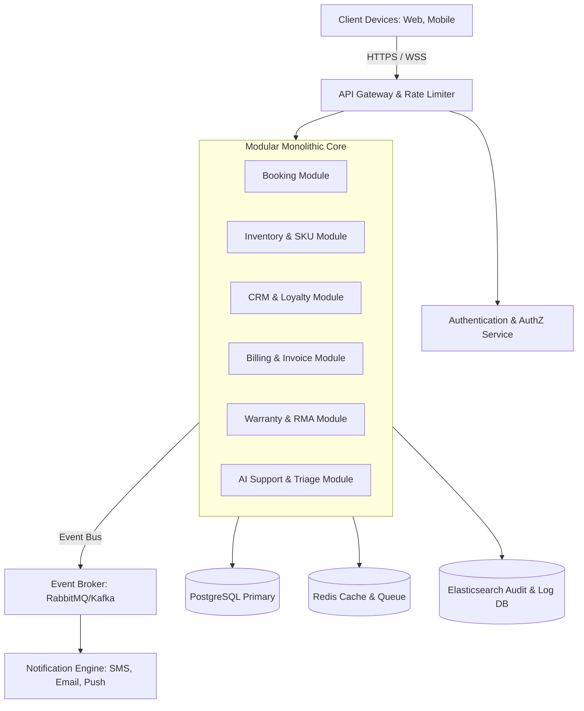
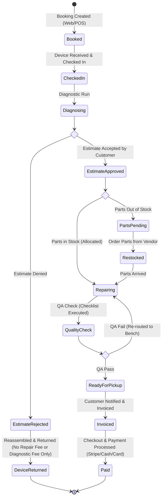
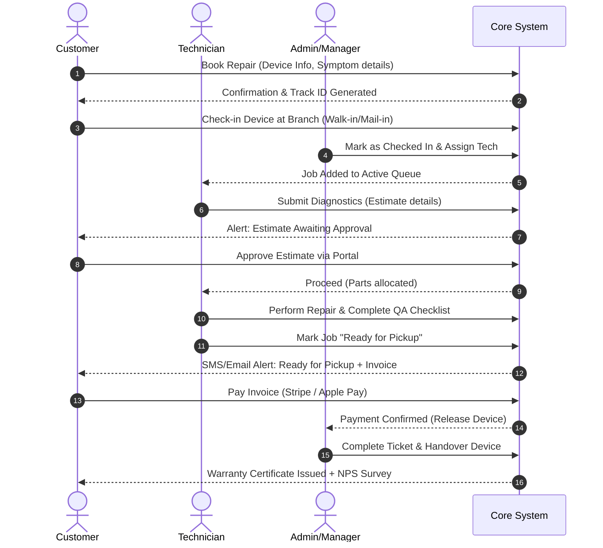
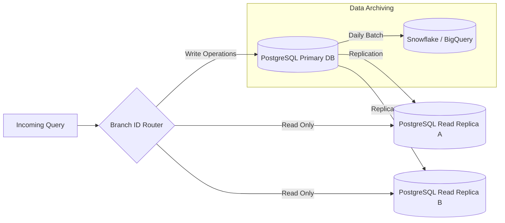

# Software Requirement Specification (SRS)
## TrustZone Mobile Care — Enterprise Business Management System

---

## 1. Introduction

### 1.1 Purpose
This document specifies the Software Requirement Specification (SRS) for the **TrustZone Mobile Care** platform. It provides a comprehensive architectural blueprint, functional modules, non-functional requirements, data flows, and security protocols required to build a modern, enterprise-ready, multi-tenant capable business management system for mobile repair and service centers.

### 1.2 Scope
The system will manage the entire lifecycle of a mobile repair shop, transitioning from a single-store operation to a multi-branch enterprise. It includes a customer-facing portal, unified administrative and technician dashboards, an automated booking engine, real-time tracking, inventory management, customer relationship management (CRM), automated invoicing, payment integration, multi-channel notifications, and AI-driven support.

### 1.3 Definitions, Acronyms, and Abbreviations
*   **SRS**: Software Requirement Specification
*   **CRM**: Customer Relationship Management
*   **RBAC**: Role-Based Access Control
*   **FIFO**: First In, First Out (Inventory Valuation)
*   **SKU**: Stock Keeping Unit
*   **RMA**: Return Merchandise Authorization (Warranty returns)
*   **SLA**: Service Level Agreement
*   **PCI-DSS**: Payment Card Industry Data Security Standard
*   **GDPR**: General Data Protection Regulation

---

## 2. System Architecture Overview

The system is designed using a **Modular Monolith** architecture with clear domain boundaries, allowing seamless extraction into **Microservices** (e.g., Booking Service, Inventory Service, CRM) as the enterprise grows.

---

## 3. Functional Requirements

### 3.1 Customer Website (Public Portal)
*   **FR-1.1 (Landing Page):** Provide a high-converting, SEO-optimized landing page showcasing services, pricing estimates, brand coverages (Apple, Samsung, Google, etc.), and customer reviews.
*   **FR-1.2 (Interactive Estimate Calculator):** Allow users to select device type, brand, model, and issue type to receive an instant repair cost estimate.
*   **FR-1.3 (Multi-Language Toggle):** Enable real-time language localization (English, Spanish, French, etc.) based on user selection or browser language headers.
*   **FR-1.4 (Blog Section):** A built-in blog system supporting categorization, rich content authoring (Markdown/RichText), and automated SEO metadata generation.

### 3.2 Booking System
*   **FR-2.1 (Booking Workflows):** Support Mail-in repair requests, Walk-in appointment scheduling, and Home/Office pick-up requests.
*   **FR-2.2 (Slot Reservation):** Offer real-time slot availability based on technician scheduling, active workload, and branch capacity.
*   **FR-2.3 (Intelligent Diagnostics Wizard):** Guide customers through step-by-step diagnostic questions to pre-identify issues using decision trees.

### 3.3 Customer Dashboard
*   **FR-3.1 (Repair Tracking Timeline):** Display a real-time visual progress tracker (e.g., "Received", "Diagnosing", "Parts Pending", "In Repair", "Quality Check", "Ready for Pickup").
*   **FR-3.2 (Invoice & Payment History):** Allow viewing, downloading, and paying invoices online via integrated gateways.
*   **FR-3.3 (Device Vault):** Keep records of customer-registered devices, including serial numbers/IMEIs, service history, active warranties, and device health tips.

### 3.4 Technician Dashboard
*   **FR-4.1 (Job Queue Management):** Show prioritized tasks assigned to the technician, filtered by SLA urgency, parts availability, and device type.
*   **FR-4.2 (Digital Repair Log):** Allow technicians to log repair progress, record internal diagnostics, upload evidence photos/videos of physical damage, and request parts from inventory.
*   **FR-4.3 (Diagnostics Checklist):** Require check-off of pre- and post-repair quality assurance steps (e.g., screen responsiveness, camera functions, battery health, Wi-Fi connectivity) before marking a job "Ready for QA".

### 3.5 Inventory Management
*   **FR-5.1 (Multi-Location Stock Control):** Manage parts stock levels dynamically across multiple physical branches and central warehouses.
*   **FR-5.2 (Automated Reorder Trigger):** Automatically generate purchase requests or alert managers when parts fall below defined buffer limits.
*   **FR-5.3 (Barcode & QR Scanning):** Support rapid check-in, check-out, and stock allocation using hardware or mobile camera scanner integrations.
*   **FR-5.4 (FIFO Tracking):** Trace parts ingestion batches to calculate precise profit margins and depreciation values.

### 3.6 Customer Relationship Management (CRM)
*   **FR-6.1 (360-Degree Customer View):** Consolidate communication logs (Email, SMS, Chat), transaction records, feedback loops, and customer preferences.
*   **FR-6.2 (Automated Follow-ups):** Trigger post-service reviews and satisfaction surveys (NPS) 3 days after ticket closure.
*   **FR-6.3 (Loyalty Program):** Credit points for every dollar spent, redeemable on accessories or future service labor.

### 3.7 Warranty & RMA Management
*   **FR-7.1 (Automated Warranty Registration):** Auto-generate electronic warranty certificates upon successful repair checkout, linked to serial numbers/IMEIs.
*   **FR-7.2 (Claim Resolution Lifecycle):** Manage warranty claims, verifying eligibility windows and checking previous repair history to approve or deny claims.
*   **FR-7.3 (Vendor RMA Tracking):** Log defective parts returned to suppliers for refunds or credits.

### 3.8 Invoice & Billing System
*   **FR-8.1 (Automated Invoice Generation):** Create PDF invoices including parts used, labor hours, tax percentages, discounts, and terms of service.
*   **FR-8.2 (Split & Partial Payments):** Allow deposits, partial cash/credit splits, and deferred payments for corporate clients.
*   **FR-8.3 (Tax Compliance):** Dynamically apply state, federal, or country-specific sales taxes based on the branch location context.

### 3.9 Payment Gateway Integration
*   **FR-9.1 (Omnichannel Processing):** Integrate Stripe/Adyen/PayPal for online credit card processing, Apple Pay/Google Pay for tap-to-pay, and physical POS terminal integrations (Stripe Terminal, Square) for in-store checkout.

### 3.10 Notification Engine
*   **FR-10.1 (Dynamic Event Notifications):** Dispatch instant notifications via SMS (Twilio), Email (SendGrid), and Push notifications (Firebase Cloud Messaging) upon status transitions (e.g., ticket generated, repair completed, invoice unpaid reminder).

### 3.11 Enterprise Analytics & Reporting
*   **FR-11.1 (Branch Analytics):** Visualize revenue, average ticket values, labor utilization rates, and parts usage metrics on custom dashboards.
*   **FR-11.2 (SLA Breaches):** Highlight tasks that missed their SLA deadlines for manager review.

### 3.12 AI-Powered Support & Triage
*   **FR-12.1 (Customer AI Bot):** Deploy a conversational AI chatbot on the portal capable of tracking order statuses, suggesting troubleshooting steps, and scheduling bookings.
*   **FR-12.2 (AI Tech Co-Pilot):** Suggest common repair pathways and reference manual links to technicians based on model and symptoms.

### 3.13 Administration Dashboard
*   **FR-13.1 (Global Settings & Controls):** Manage system users, set RBAC roles, configure tax rates, add/remove physical branches, and adjust service catalog items and base prices.

---

## 4. Non-Functional Requirements

### 4.1 Performance & Latency
*   **NFR-1.1:** Standard API responses must be returned within `< 200ms` under normal load.
*   **NFR-1.2:** Single Page Application (SPA) load time must be `< 1.5` seconds (LCP) on 4G connections.
*   **NFR-1.3:** Search queries within inventory and booking databases must be indexed to execute in `< 50ms`.

### 4.2 Availability & Reliability
*   **NFR-2.1:** High availability target of `99.95%` uptime, excluding planned maintenance windows.
*   **NFR-2.2:** RTO (Recovery Time Objective) `< 1 hour` and RPO (Recovery Point Objective) `< 5 minutes` using streaming replica databases.

### 4.3 Security & Regulatory Compliance
*   **NFR-3.1:** All transit data must be encrypted using TLS 1.3; data at rest must use AES-256.
*   **NFR-3.2:** Fully PCI-DSS compliant processing (utilizing hosted fields/tokenization to avoid storing raw card data).
*   **NFR-3.3:** GDPR compliant mechanics, providing clear opt-out channels and data export capabilities.

### 4.4 Scalability & Extensibility
*   **NFR-4.1:** The database must be structured with partition support for tenant IDs (branches) to support scaling up to 10,000+ bookings per day.
*   **NFR-4.2:** API design must adhere strictly to RESTful practices and GraphQL specifications with semantic versioning.

### 4.5 Usability
*   **NFR-5.1:** Responsive layout supporting layouts for mobile (5.5"+), tablet (9"+), and desktop views.
*   **NFR-5.2:** Interface design must meet WCAG 2.1 AA accessibility guidelines (contrast ratios, keyboard navigation, aria-labels).

---

## 5. System Flows & Processes

### 5.1 Business Lifecycle Flow
This flowchart details the journey of a customer device from the initial booking, diagnostics, repair execution, up to completion, invoicing, and restocking actions.

### 5.2 User Interactions & Actions

---

## 6. Comprehensive Security Plan

### 6.1 Authentication & Authorization Matrix
The system uses OAuth2 with OpenID Connect (OIDC) via Auth0, Firebase Auth, or a self-hosted Keycloak cluster.

| User Role | Access Level | Permitted Operations |
| :--- | :--- | :--- |
| **Customer** | Self-Owned Scope | View own details, book services, track own tickets, make payments, write reviews. |
| **Technician** | Workstation Scope | Read assigned tickets, update ticket statuses, claim parts, record diagnostics, log labor. |
| **Branch Manager** | Branch Scope | CRUD operations on branch tickets, local inventory lookup, schedule staff, issue refunds. |
| **Global Admin** | Tenant-Wide Scope | Multi-branch configuration, financial reporting, system configurations, master database access. |

### 6.2 Data Security & Auditing Strategy
*   **Field-Level Encryption:** Sensitive customer details (such as physical address, phone numbers, and IMEI identifiers) are encrypted at-rest using AES-256 GCM at the application level.
*   **Audit Logging Database:** Every mutation (INSERT, UPDATE, DELETE) across billing and inventory models is mirrored via Change Data Capture (CDC) using Debezium into a read-only write-once-read-many (WORM) Elasticsearch cluster.
*   **Rate Limiting & DDoS Prevention:** Cloudflare WAF handles edge traffic protection. IP-based and user-token-based rate limits (max 100 requests/min per user token) are enforced at the API Gateway.

---

## 7. Scalability & Data Architecture Plan

### 7.1 Database Scaling Strategy
To handle growth from a single shop to thousands of branches, a tiered database scaling strategy is established:

1.  **Horizontal Read Scaling:** Deploy read replicas. Route reporting, analytics, and customer lookups to replicas, keeping the master instance reserved for write transactions (bookings, payments, inventory updates).
2.  **Sharding Path:** Implement database sharding based on `tenant_id` (Branch ID) once database sizes exceed 5TB.
3.  **Caching Tier:** Redis caches common query patterns (such as parts catalogs, model indices, and branch information) with TTLs.

### 7.2 Microservices Transition Path
When scaling limits are reached, decouple the modular monolith into independent services:
*   **Stage 1:** Extract the **Notification Module** (highly asynchronous, heavy I/O).
*   **Stage 2:** Extract the **Inventory Module** to handle inventory sync without impacting core ticket creation logic.
*   **Stage 3:** Extract the **AI Triage & Helpdesk** to a serverless (FaaS) infrastructure, isolating heavy compute tasks from transactional databases.

---

## 8. Future Expansion & Integration Plan

### 8.1 Multi-Platform Mobile Apps (iOS & Android)
*   **Architecture Strategy:** Utilize a single shared codebase (Flutter or React Native) that interfaces directly with the REST/GraphQL endpoints exposed by the API Gateway.
*   **Mobile-Specific Features:**
    *   **Native Push Alerts:** System transitions trigger native push notifications.
    *   **On-Device Scanner:** Integrated QR/barcode scanner utilizing the device's native camera for field technicians.
    *   **Offline Mode:** Essential diagnostic sheets can be accessed offline by technicians, syncing up once connection resumes.

### 8.2 IoT Diagnostics Integration
*   **Smart Bench Integration:** Connect to smart multimeters, USB-C testers, and power monitors to automatically log diagnostic currents, voltages, and thermal images directly to the active repair log.
*   **Automated Diagnostics Apps:** An optional diagnostic app installed on client devices to check battery health, touch responsiveness, and sensor operations, uploading diagnostic reports automatically to the ticket before physical check-in.

### 8.3 Enterprise White-Label Support
*   **B2B Client Portals:** Custom-branded subdomains for enterprise accounts (e.g., corporate office fleet management, school district tablet programs).
*   **Automated EDI Feeds:** Electronic Data Interchange (EDI) feeds to allow enterprise partners to dispatch ticket orders directly into the TrustZone Mobile Care intake queue.
