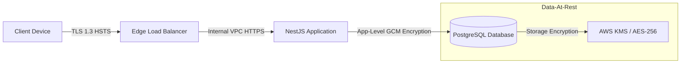

# System Security Audit & Hardening Specification
## TrustZone Mobile Care — Enterprise Security Architecture

---

## 1. Authentication & Session Security

Our authentication model is designed to prevent brute-force attacks, session hijacking, and account takeovers.

### 1.1 Authentication Hardening
*   **Multi-Factor Authentication (MFA):** Mandated for all administrative, manager, and technician accounts. Supported formats: TOTP (Authenticator Apps like Google Authenticator) and WebAuthn (FIDO2 Hardware Keys/Passkeys).
*   **Brute-Force Lockout:** Account locking occurs after `5 consecutive failed login attempts` within a 15-minute window. Locks are enforced for 30 minutes, combined with automated security emails dispatched to the user's primary inbox.

### 1.2 JWT & Session Strategy
*   **Token Cryptography:** Access tokens are signed using asymmetric **RS256** (RSA Signature with SHA-256) keys. The private key resides securely inside an AWS Secret Manager wrapper, while the public key is distributed locally to api-gateways for signature decoding.
*   **Session Lifecycle:**
    *   *Access Token:* `15-minute expiration`. Transmitted via the `Authorization: Bearer <JWT>` header.
    *   *Refresh Token:* `7-day expiration`. Transmitted exclusively inside a secure, `HttpOnly`, `SameSite=Strict`, `Secure` cookie.
*   **Refresh Token Rotation (RTR):** Every time a refresh token is used to obtain a new access token, the old refresh token is invalidated, and a new one is issued. If a family of refresh tokens receives a replay request from an old token, the entire session chain is immediately revoked in Redis to protect against token leakage.
*   **Revocation Blacklist:** Logouts and role revocations write the active Access Token's fingerprint into a Redis cache with a TTL matching the token's remaining lifespan. The `JwtAuthGuard` intercepts requests and matches them against this blacklist.

---

## 2. Authorization & Database Security

We implement access controls at both the application API layer and the raw database storage layer.

### 2.1 Role-Based (RBAC) & Attribute-Based (ABAC) Access Control
*   **RBAC Layer:** Guards evaluate incoming endpoints against the user's assigned role matrix (Admin, Manager, Tech, Customer).
*   **ABAC Layer:** For resource mutations (e.g., updating a ticket), the system validates context parameters (e.g., `ticket.assigned_tech_id === current_user.id`).
*   **Row-Level Security (RLS):** Implemented directly within the PostgreSQL database core:
    ```sql
    CREATE POLICY branch_isolation_policy ON core.tickets
        FOR ALL USING (branch_id = current_setting('app.current_branch_id', true)::uuid);
    ```
    This policy guarantees that managers and technicians cannot view or modify tickets belonging to other physical branches, even if their application query is misconfigured.

### 2.2 Database Layer Protection
*   **Least Privilege Roles:** The backend connects to PostgreSQL using three separate application users:
    1.  `app_reader`: Read-only permissions on select tables (e.g., parts catalog, public blog).
    2.  `app_writer`: CRUD permissions on core transactions (bookings, invoices, inventory).
    3.  `app_migrator`: Dedicated role with DDL permissions, run only during migration deploy steps.
*   **SQL Injection Prevention:** Direct SQL queries are prohibited. All database queries must run through the Prisma ORM, which compiles query parameters into prepared statements.

---

## 3. Data Encryption Standards

Data is encrypted both in transit and at rest to maintain confidentiality.



### 3.1 Encryption In Transit
*   **Protocols:** TLS 1.3 is required. Support for legacy protocols (TLS 1.0, 1.1, and older ciphers) is disabled.
*   **Strict Headers:** Enforced via HTTP Strict Transport Security (HSTS) with a `max-age` of 2 years, including subdomains and preloading tags.

### 3.2 Encryption At Rest (Envelope Encryption)
*   **Storage Volume Encryption:** Primary database volumes and active replication drives run under AES-256 storage volume encryption.
*   **Application Field-Level Encryption:** Sensitive fields (IMEIs, serial numbers, customer phone numbers, and physical addresses) are encrypted *before* database insertion.
    *   *Algorithm:* `AES-256-GCM` using a unique key derived from a master key kept in AWS Key Management Service (KMS).
    *   *Vector:* Unique initialization vector (IV) generated for each encryption call.

---

## 4. OWASP Top 10 Protections & API Hardening

Our API layer includes specific defenses against common security vulnerabilities.

### 4.1 Injection & Cross-Site Scripting (XSS)
*   **Prisma Parameterization:** Protects against SQL injection by separating code from data.
*   **Input Sanitization:** DTO pipelines run input strings through DOMPurify/validator sanitizers to strip out executable script scripts, protecting against Stored and Reflected XSS.
*   **Content Security Policy (CSP):** Enforced via HTTP headers (Helmet middleware) to restrict JavaScript execution to trusted domains.

### 4.2 Cross-Site Request Forgery (CSRF)
*   **Cookie SameSite Binds:** Session refresh cookies use `SameSite=Strict` policies, preventing browsers from appending credentials to cross-site requests.
*   **State-Verification Headers:** Mutation requests require custom validation headers (e.g., `X-XSRF-TOKEN`), which must be supplied programmatically by the Client application.

### 4.3 Server-Side Request Forgery (SSRF) & CORS
*   **Strict CORS Policy:** Restricted to approved origin domains (e.g., `https://*.trustzone.care`). Wildcard (`*`) configurations are blocked in production.
*   **Egress Control:** VPC security groups restrict outbound network calls from application servers, blocking calls to local loopback addresses (`127.0.0.1`) and cloud metadata services (`169.254.169.254`).

---

## 5. Rate Limiting & DDoS Shielding

DDoS protection is implemented at both the DNS edge and the application gateway.

*   **Edge Defense (WAF):** Cloudflare Enterprise sits in front of the platform to handle DNS, serve as a Web Application Firewall (WAF), mitigate DDoS attacks, and block automated scrapers.
*   **Throttler Configuration:**
    ```
    - Auth (Login/Reset): Max 5 requests / minute (IP-based block)
    - Booking Submissions: Max 3 requests / minute (Token-bucket validation)
    - Global API Access: Max 120 requests / minute (Rate Limiter Guard)
    ```

---

## 6. Security Logging, Monitoring, and Backups

This section details auditing protocols, immutable backup strategies, and real-time monitoring.

### 6.1 Audit Trails & Security Logging
*   **Change Data Capture (CDC):** Database mutations are mirrored via Debezium to write-once Elasticsearch logs, creating an unalterable audit trail.
*   **Sensitive Log Scrubbing:** Winston logger filters run before logging outputs, automatically replacing patterns matching credit cards, passwords, or raw session tokens with a `[REDACTED]` string.

### 6.2 Immutable Cloud Backups
*   **Backup Storage:** Backups are written to AWS S3 using **Object Lock** in compliance-mode. This locks files for 30 days, preventing deletions or modifications even if administrative credentials are compromised.
*   **Disaster Recovery (PITR):** Write-Ahead Logs (WAL) are shipped every 60 seconds to support Point-in-Time Recovery to any millisecond within the previous 14 days.
*   **Backup Drills:** Auto-restore scripts build sandbox instances weekly to verify restore integrity.

### 6.3 Real-Time Monitoring & Alerts
*   **SIEM Streaming:** Logs stream to Datadog / Splunk clusters.
*   **High-Priority Alerts:** Alerts trigger page notifications to the security operations team (via PagerDuty) if the following indicators occur:
    *   *Failed log-ins:* > 50 failed login attempts across the system within 5 minutes.
    *   *Bulk exports:* > 5 customer list CSV export requests within 10 minutes.
    *   *Inventory drift:* > 50 SKU quantity modifications executed outside of ticket completion events.
