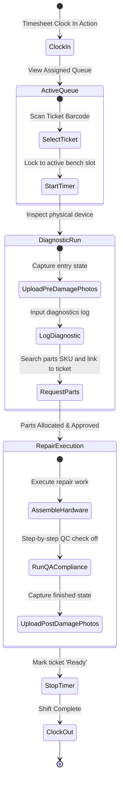

# Technician System Layout & Workflow Specification
## TrustZone Mobile Care — Technician Workspace Portal

---

## 1. Bench Interface Layout & Nav Frame

The Technician Console features a **dark-mode high-contrast layout** optimized for high-brightness workbench monitors and mobile tablets. It places toolbars, checklists, and parts search controls within easy reach.

```
+---------------------------------------------------------------------------------------------------+
|  [TECH BENCH #3]  Marcus |  Active Status: [ CLOCKED IN (08:30) ]   | Alert: [ Low Stock Alert ] [M] |
+---------------------------------------------------------------------------------------------------+
|  (Workbench Nav)          |  (Bench Workspace Canvas)                                             |
|  * Active Queue (SLA)     |  Bench Workstation #3 — Active Repair                                 |
|  * Work History           |                                                                       |
|  * Inventory SKU Lookup   |  +-- CURRENT ACTIVE JOB TICKET: #TZ-9921 ---------------------------+ |
|  * Timesheet & Attendance |  | Device: iPhone 14 Pro  | Priority: [ SLA: HIGH (2h remaining) ]  | |
|  * Performance Analytics  |  | Symptom: Cracked Screen & Touch Deadzone                            | |
|                           |  | [ Proceed with Diagnostic Log ]                                     | |
|                           |  +---------------------------------------------------------------------+ |
+---------------------------------------------------------------------------------------------------+
```

### 1.1 Keyboard & Barcode Scanner Integration
*   **Barcode Scanning:** Connecting a USB barcode scanner allows technicians to scan a ticket's barcode to open it instantly. Scanning a parts box SKU adds it to the active ticket's parts usage list.
*   **Responsive Viewports:**
    *   **Desktop Workbench Monitor:** Split-screen mode: assigned job list on the left, repair log and checklist on the right.
    *   **Tablet Bench Display:** Full-screen step sequence cards. Double-tap to confirm checklist items.

---

## 2. Screen-by-Screen Layout Specifications

### 2.1 Screen 1: Workbench Queue & Active Assignment
Displays the list of prioritized tickets assigned to the logged-in technician.

#### Wireframe & Component Hierarchy
```
+---------------------------------------------------------------------------------------------------+
|  Active Workbench Queue                                                    Shift: [ Clocked In ]  |
+---------------------------------------------------------------------------------------------------+
|  +-- ASSIGNED JOBS QUEUE ----------------------------------------------------------------------+  |
|  | Ticket ID | Device         | SLA Urgency       | Stage Status      | Customer Notes | Action |  |
|  |-----------|----------------|-------------------|-------------------|----------------|--------|  |
|  | #TZ-9921  | iPhone 14 Pro  | Overdue in 1h 45m | [Diagnosing]      | Screen dead    | [BENCH]|  |
|  | #TZ-9955  | Galaxy S23     | Today, 5:00 PM    | [Waiting Parts]   | Battery dead   | [VIEW] |  |
|  | #TZ-9988  | iPad Air       | Tomorrow, 12:00 PM| [Booked]          | Ports loose    | [VIEW] |  |
|  +---------------------------------------------------------------------------------------------+  |
|  * Click [BENCH] to lock ticket to active work slot, starting the labor stopwatch timer.           |
+---------------------------------------------------------------------------------------------------+
```

---

### 2.2 Screen 2: Active Repair Workspace (Log & Checklist)
The workspace for updating ticket logs, requesting parts, and verifying quality control checklists.

#### Wireframe & Component Hierarchy
```
+---------------------------------------------------------------------------------------------------+
|  Workbench: Ticket #TZ-9921                                                    Labor Timer: 24:12 |
+---------------------------------------------------------------------------------------------------+
|  +-- CUSTOMER COMPLAINT NOTES ------------+ +-- INVENTORY PARTS ALLOCATION REQUEST ---------------+  |
|  | "Dropped screen in pool, touchscreen   | | Search parts catalog: [ OLED iPhone 14...     ] (+) |  |
|  | is unresponsive in lower right quad."  | |---------------------------------------------------|  |
|  +----------------------------------------+ | Part Code   | Description     | Cost   | Status     |  |
|  +-- TECHNICIAN DIAGNOSTICS LOG ----------+ |-------------|-----------------|--------|------------|  |
|  | [ Replaced OLED screen. Frame had      | | AP-OLED14   | iPhone 14 OLED  | $150.00| Allocated  |  |
|  | minor denting, shaped back to size. ]  | +---------------------------------------------------+  |
|  +----------------------------------------+ +-- QA POST-REPAIR CHECKLIST ------------------------+  |
|  | [x] Touch grid deadzone test passed    | | [x] Front/Back Camera Clear   | [ ] Charge Rate OK  |  |
|  +----------------------------------------+ +---------------------------------------------------+  |
|  Action Buttons: [ Hold: Waiting Parts ]     [ Hold: Customer Query ]     [ Proceed to QA Photos > ]|
+---------------------------------------------------------------------------------------------------+
```

---

### 2.3 Screen 3: Media Upload & Evidence Gallery
Handles uploading and annotating photos of physical damage to document pre- and post-repair states.

#### Wireframe & Component Hierarchy
```
+---------------------------------------------------------------------------------------------------+
|  Evidence Gallery: Ticket #TZ-9921                                                                 |
+---------------------------------------------------------------------------------------------------+
|  +-- DRAG-AND-DROP UPLOAD ZONE ----------------------------------------------------------------+  |
|  | [ Drag & Drop Pre-Repair / Post-Repair photos or Click to Upload using device camera ]       |  |
|  +---------------------------------------------------------------------------------------------+  |
|                                                                                                   |
|  +-- UPLOADED IMAGES --------------------------------------------------------------------------+  |
|  | [ Image: Cracked Screen ]              | [ Image: New Display Installed ]                      |  |
|  | Tag: Pre-Repair Damage                 | Tag: Post-Repair Finished                             |  |
|  | Description: Crack at bottom edge      | Description: Display test grid clear                  |  |
|  | [ Delete ]                             | [ Delete ]                                            |  |
|  +---------------------------------------------------------------------------------------------+  |
|  Action Buttons: [ Back to Bench ]                                            [ Complete Repair ] |
+---------------------------------------------------------------------------------------------------+
```

---

### 2.4 Screen 4: Work History Logs
Logs past repairs completed by the technician to track work credits and billing references.

#### Wireframe & Component Hierarchy
```
+---------------------------------------------------------------------------------------------------+
|  My Completed Work History                                                   Range: [ Last 30d ]  |
+---------------------------------------------------------------------------------------------------+
|  +-- HISTORY MATRIX ---------------------------------------------------------------------------+  |
|  | Date Closed | Ticket ID  | Device Name   | Repair Action Taken     | Parts Used  | Labor Hours |  |
|  |-------------|------------|---------------|-------------------------|-------------|-------------|  |
|  | 2026-07-07  | #TZ-9811   | iPad Air 4    | Replaced battery block  | IPD-BATT    | 1h 15m      |  |
|  | 2026-07-05  | #TZ-9800   | Galaxy S23    | Swapped damaged port    | SM-USB23    | 0h 45m      |  |
|  | 2026-07-02  | #TZ-9788   | iPhone 13     | Screen swap + adhesive  | IP-SCR13    | 1h 05m      |  |
|  +---------------------------------------------------------------------------------------------+  |
|  * Aggregate Work Credits: 48 Repairs completed. Total labor time logged: 54 hours.              |
+---------------------------------------------------------------------------------------------------+
```

---

### 2.5 Screen 5: Timesheet, Attendance & Metrics Dashboard
Tracks shift hours and displays key performance metrics like repair speeds and customer satisfaction scores.

#### Wireframe & Component Hierarchy
```
+---------------------------------------------------------------------------------------------------+
|  Timesheet & Performance Dashboard                                                                |
+---------------------------------------------------------------------------------------------------+
|  +-- SHIFT RECORD (ATTENDANCE) ----------+ +-- PERFORMANCE METRICS -----------------------------+  |
|  | Status: [ CLOCKED IN ] (08:30:12)     | | Average Repair Speed:  54 minutes / device         |  |
|  | Today's Hours: 6h 12m                 | | SLA Success Rate:      98.2% (Target: 95%)         |  |
|  | [ Clock Out ]  [ Request Time Off ]   | | Customer Rating:       4.9 / 5.0                   |  |
|  +---------------------------------------+ +----------------------------------------------------+  |
|  +-- WEEKLY SHIFT HISTORY ---------------------------------------------------------------------+  |
|  | * Mon, Jul 6:   08:30 - 17:00 (8.5h)  | * Wed, Jul 8:  08:30 - Active (6.2h)                 |  |
|  | * Tue, Jul 7:   08:15 - 17:00 (8.75h) |                                                      |  |
|  +---------------------------------------------------------------------------------------------+  |
+---------------------------------------------------------------------------------------------------+
```

---

## 3. Complete Technician Workflow


*   **Workflow Integration:** Marking a job as "Ready" stops the labor timer. It automatically updates the customer profile database and sends a notification through the event-bus engine.
