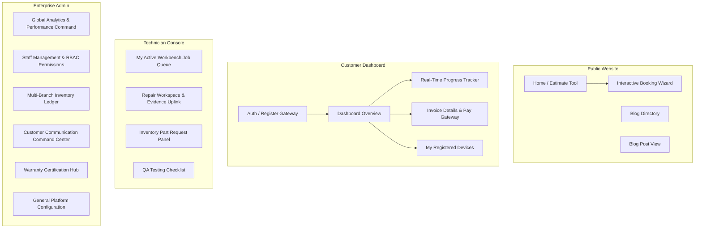
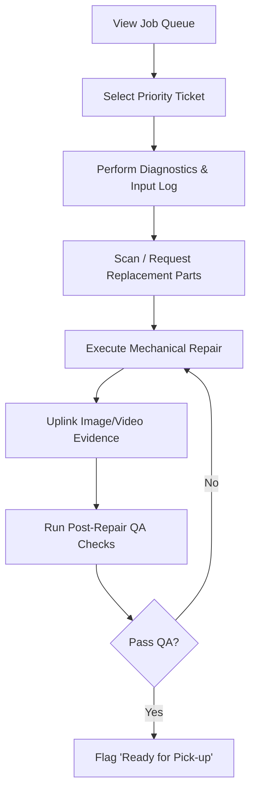

# UI/UX Design System & Layout Specification
## TrustZone Mobile Care — Enterprise Platform UX Architecture

---

## 1. Design System & Enterprise UI Principles

### 1.1 Design Philosophy & Aesthetics
TrustZone Mobile Care's interface is built on a foundation of **Trust, Precision, and Clarity**. Since customers entrust the system with high-value personal devices, the UI must feel secure, professional, and visually premium. 

*   **Visual Style:** Modern Dark-Mode-First design language with subtle Glassmorphism (acrylic material blurs) to signify premium quality.
*   **Micro-interactions:** Smooth spring physics (0.2s duration) on hover states, cards, and interactive elements.
*   **Accessibility:** AAA compliance targets, support for system font-scaling, and high-contrast color choices.

### 1.2 Global Color Tokens
We utilize a tailored HSL-based palette that balances clinical precision with modern technology vibes:

| Token Name | HSL Value | Application / Meaning |
| :--- | :--- | :--- |
| **Brand Primary (Cobalt)** | `hsl(220, 90%, 56%)` | Core actions, primary brand highlights, focal points. |
| **Brand Secondary (Emerald)** | `hsl(142, 70%, 45%)` | Success states, completed stages, paid statuses, secure channels. |
| **Brand Accent (Amber)** | `hsl(38, 92%, 50%)` | Alerts, actions pending user input (e.g., approve diagnostics). |
| **Background Dark (Deep Slate)** | `hsl(222, 47%, 11%)` | Primary canvas color for dashboard views. |
| **Surface Dark (Slate Acrylic)**| `hsl(224, 71%, 4%)` | Card components, dialogue modals, utility menus. |
| **Text Primary (Snow)** | `hsl(210, 40%, 98%)` | High-emphasis content, titles, text block headers. |
| **Text Secondary (Muted Gray)** | `hsl(215, 20%, 65%)` | Captions, descriptions, metadata, inactive tabs. |

### 1.3 Typography
*   **Headings:** *Outfit* (Geometric, premium, high-tech sans-serif).
*   **Body Copy:** *Inter* (Highly legible, crisp terminal text, excellent legibility on small mobile viewports).

### 1.4 Responsive Layout Grid System
*   **Desktop (1440px+):** 12-column grid | 24px gutters | 80px margins.
*   **Tablet (768px - 1023px):** 8-column grid | 16px gutters | 32px margins.
*   **Mobile (320px - 767px):** 4-column grid | 12px gutters | 16px margins.

---

## 2. Platform Sitemap

The sitemap defines the hierarchical directory structure across the three main user interfaces.



---

## 3. Core UX Flows

### 3.1 Customer Booking & Progress Journey

```mermaid
flowchart LR
    Start([Customer Website]) --> Estimate[Compute Estimate]
    Estimate --> BookWizard[Complete Booking Wizard]
    BookWizard --> CheckIn[Drop-off/Mail Device]
    CheckIn --> AlertDiag[Alert: Review Diagnostic]
    AlertDiag --> AcceptDiag[Accept Estimate via Portal]
    AcceptDiag --> WaitRepair[Track Live Progress Timeline]
    WaitRepair --> AlertPickup[Alert: Ready + Invoice]
    AlertPickup --> StripePay[Process Payment Online]
    StripePay --> Handover([Collect Device + Warranty])
```


### 3.2 Technician Repair Sequence


---

## 4. Responsive Wireframe Specifications & Layouts

### 4.1 Home Page & Estimate Engine

#### Desktop Wireframe (1440px)
```
+---------------------------------------------------------------------------------+
|  LOGO  [TrustZone]      Services   Estimates   Blog  | [Book Now]  [Dashboard]  |
+---------------------------------------------------------------------------------+
|                                                                                 |
|   PRECISE DEVICE CARE                                  [ ESTIMATE CALCULATOR ]  |
|   Modern Enterprise Repairs.                           +---------------------+  |
|   Trusted by Thousands.                                | Select Brand  (v)   |  |
|   [ Schedule Service ]                                 | Select Model  (v)   |  |
|                                                        | Select Issue  (v)   |  |
|   * * * * * (4.9/5 Rating)                             +---------------------+  |
|                                                        | Total: $129.00      |  |
|                                                        | [Book This Repair]  |  |
|                                                        +---------------------+  |
+---------------------------------------------------------------------------------+
|  [Apple Approved]    [Samsung Network]    [Google Authorized]   [24h Turnaround]|
+---------------------------------------------------------------------------------+
```
*   **UX Strategy:** Split-screen layout. Left side hosts the brand value proposition and call-to-action buttons. Right side holds the sticky interactive Calculator Card.
*   **Aesthetics:** Dark slate background with a vibrant cobalt blue glow behind the Calculator Card to focus user attention immediately.

#### Tablet Grid Adaptation (768px)
*   **Layout Shift:** The layout changes to a single-column stack. The Value Proposition slides to the top, and the Estimate Calculator follows directly below it.
*   **Navigation:** Top navigation links collapse into a simple visual icon menu (Hamburger style).

#### Mobile Wireframe (320px)
```
+-------------------+
| =  [LOGO]     [X] |
+-------------------+
| PRECISE DEVICE    |
| CARE.             |
| [ Book Now ]      |
+-------------------+
|  [ CALCULATOR ]   |
| Brand: Apple (v)  |
| Model: iP 15 (v)  |
| Issue: Screen (v) |
|                   |
| Total: $129.00    |
| [Book Repair]     |
+-------------------+
```
*   **UX Strategy:** Full-width stack. Input dropdowns are enlarged to 48px height to provide touch-friendly inputs. The sticky floating book button remains locked to the bottom of the screen.

---

### 4.2 Customer Dashboard & Repair Timeline

#### Desktop Wireframe (1440px)
```
+---------------------------------------------------------------------------------+
|  [LOGO]  Overview   My Devices   Billing   |   Active Tracker: Ticket #TZ-9921  |
+---------------------------------------------------------------------------------+
|  Welcome Back, Alex!                                                            |
|                                                                                 |
|  +-- TRACK YOUR DEVICE ------------------------------------------------------+  |
|  |  (x) Booked  --->  (x) Checked In  --->  (/) Repairing  --->  ( ) Ready    |  |
|  +---------------------------------------------------------------------------+  |
|                                                                                 |
|  +-- JOB DETAIL -------------------------+ +-- ESTIMATE APPROVAL ------------+  |
|  | Device: iPhone 14 Pro                 | | Diagnostic Report:              |  |
|  | Serial: DX892100                      | | Cracked OLED & Damaged Frame.   |  |
|  | Assigned Tech: Marcus (Bench #3)      | | Cost: $220.00 (Breakdown)       |  |
|  | ETA: Today, 5:00 PM                   | | [ Approve Repair ] [ Decline ]  |  |
|  +---------------------------------------+ +---------------------------------+  |
+---------------------------------------------------------------------------------+
```
*   **UX Strategy:** High-contrast progress bar using HSL Success Green for completed states and glowing Cobalt for active states.
*   **Actions:** If the ticket state is `Diagnosing` and requires approval, a prominent system notification card pops up dynamically using the Amber highlight token to block other elements until approved or declined.

#### Tablet Grid Adaptation (768px)
*   **Layout Shift:** The progress tracker flips from a horizontal line to a vertical sidebar component to prevent text clipping. Detail Card and Estimate Card stack vertically.

#### Mobile Wireframe (320px)
```
+-------------------+
| =  Dashboard  [A] |
+-------------------+
| TICKET #TZ-9921   |
|                   |
| [x] Checked In    |
| [x] Diagnosing    |
| [/] IN REPAIR     |
| [ ] QA Checks     |
| [ ] Ready         |
+-------------------+
| Estimate Pending: |
| OLED Screen Swap  |
| Total: $220.00    |
|                   |
| [ Approve Now ]   |
| [ Call Shop ]     |
+-------------------+
```
*   **UX Strategy:** The multi-stage horizontal bar transitions into a vertical timeline tree. The primary action button "[Approve Now]" features a persistent float anchor at the bottom of the screen, utilizing 56px height for easy thumb access.

---

### 4.3 Technician Dashboard & Repair Log

#### Desktop Wireframe (1440px)
```
+---------------------------------------------------------------------------------+
|  TECH PORTAL  [Bench #3 - Marcus]                       Shift Status: [ ACTIVE ]|
+---------------------------------------------------------------------------------+
|  +-- ACTIVE JOB QUEUE -------------+ +-- WORKBENCH TICKET #TZ-9921 ----------+  |
|  | [SLA] #TZ-9921 | iPhone 14 OLED | | Device: iPhone 14 Pro | Status: Repair|  |
|  | [Low] #TZ-9940 | iPad Battery   | | Diagnosed: Cracked OLED Display       |  |
|  | [Med] #TZ-9988 | Galaxy USB Port| +-- QA CHECKLIST -----------------------+  |
|  |                                 | | [x] Dual-Band Wi-Fi Scan Test         |  |
|  |                                 | | [ ] Screen Touch Dead-zone Test       |  |
|  |                                 | | [ ] Front/Back Camera Clear Check     |  |
|  |                                 | +---------------------------------------+  |
|  |                                 | | Request Part: [ Select SKU      ] (+) |  |
|  |                                 | | [ Upload Photo Proof ] [ Complete ]   |  |
|  +---------------------------------+ +---------------------------------------+  |
+---------------------------------------------------------------------------------+
```
*   **UX Strategy:** Master-Detail dual-pane interface. Left sidebar displays active tickets ordered by SLA priority. Right workspace handles the details and updates for the selected repair ticket.
*   **Interactive Components:** Quick-tap QA checklist items directly update the server in real-time, removing the need for manual saves.

#### Tablet Grid Adaptation (768px)
*   **Layout Shift:** Left pane collapses into a slide-out navigation drawer. The main screen space is reserved entirely for the active workbench details.

#### Mobile Wireframe (320px)
```
+-------------------+
| < Tech   #TZ-9921 |
+-------------------+
| STATUS: REPAIR    |
| iPhone 14 Pro     |
+-------------------+
| PARTS:            |
| Screen SKU-OLED14 |
| Status: ALLOCATED |
+-------------------+
| QA CHECKLIST:     |
| [x] Touch Grid    |
| [x] Face ID       |
| [ ] Audio Loop    |
+-------------------+
| [ Camera Scan QR] |
| [ Complete Job ]  |
+-------------------+
```
*   **UX Strategy:** Structured layout optimized for single-hand use. The "Camera Scan QR" button utilizes the native smartphone camera integration to quickly scan hardware barcode tags.

---

### 4.4 Admin Dashboard (Control Center)

#### Desktop Wireframe (1440px)
```
+---------------------------------------------------------------------------------+
|  ADMIN  [TrustZone Master]     Overview   Inventory   Staff   CRM   Analytics   |
+---------------------------------------------------------------------------------+
|  GLOBAL ANALYTICS COMMAND                                   Range: [ Last 30d ] |
|                                                                                 |
|  +-- REVENUE --------+ +-- TICKETS ---------+ +-- INVENTORY -----------------+  |
|  | $84,200.00        | | 420 Resolved       | | SKU Deficit: 12 Items        |  |
|  | (+14% vs Prev Mo) | | (SLA Rate: 98.2%)  | | (Auto-Orders Sent: 3)        |  |
|  +-------------------+ +--------------------+ +------------------------------+  |
|                                                                                 |
|  +-- MULTI-BRANCH STATUS -------------------+ +-- RECENT SLA BREACHES --------+  |
|  | Downtown Branch:   Active  (22 Jobs)     | | #TZ-8831 | Overdue by 2h     |  |
|  | Northside Branch:  Active  (11 Jobs)     | | #TZ-8844 | Overdue by 45m    |  |
|  | Warehouse Central: Restocked (300 SKUs)  | | [ Review Breach Reports ]    |  |
|  +------------------------------------------+ +------------------------------+  |
+---------------------------------------------------------------------------------+
```
*   **UX Strategy:** Summary Cards top the page to display key operational metrics. Mid-section split-panel provides a high-level view of Multi-Branch statuses alongside real-time SLA breach monitoring.
*   **Color Accents:** High-alert SLA breaches feature the Amber alert color block, drawing immediate manager focus.

#### Tablet Grid Adaptation (768px)
*   **Layout Shift:** Flex grid wrapper changes from a 3-column top row to a 2-column layout. The inventory card wraps below the Revenue and Ticket cards.

#### Mobile Wireframe (320px)
```
+-------------------+
| =  Admin    [Profile]|
+-------------------+
| GLOBAL REVENUE    |
| $84,200.00        |
| (+14% vs Prev Mo) |
+-------------------+
| BRANCH STATUS:    |
| Downtown:  (22)   |
| Northside: (11)   |
+-------------------+
| OUT-OF-STOCK:     |
| iPhone 13 Batt (4)|
| Galaxy S23 Port (2)|
| [ View Alerts ]   |
+-------------------+
```
*   **UX Strategy:** Condensed data lists display aggregated metrics. Graph views are replaced with simplified trend indicator icons to preserve readability on narrow viewports.

---

## 5. Screen Transitions & UX States

### 5.1 Dynamic Page Transitions
*   **Initial Page Load:** Standard CSS fade-in with y-axis transform shift (`opacity: 0 -> 1`, `transform: translateY(10px -> 0px)`) over `250ms`.
*   **State Updates (e.g., Diagnostics Approved):** The alert card slides out to the right using a spring transition while the remaining interface blocks slide upward to reclaim the space.
*   **Search Filters (Inventory):** Grid elements employ a scale-down animation (`scale(1 -> 0.95)`) during dynamic refiltering, returning smoothly back to size.

### 5.2 Common State UI Rules

```
+-- LOADING STATE (Skeleton View) -------------------------+
|  [  Title Skeleton Glow  ]                               |
|  ======================================================  |
|  [ Block Skeleton ]           [ Block Skeleton ]         |
|  ======================================================  |
+----------------------------------------------------------+
```
*   **Loading State (Skeleton Loaders):** Replace loading spinners with structural skeleton cards matching page component shapes. Content cards feature a constant pulsing light-gray background gradient.
*   **Empty State:** Empty sections feature a centered custom line-art vector icon accompanied by a short helpful prompt (e.g., "No jobs assigned. Tap 'Get Job' to start working.").
*   **Error State:** System alerts display in high-contrast red alert blocks with clear actions (e.g., "Transaction Failed: Check network connectivity. [ Retry Connection ]").
