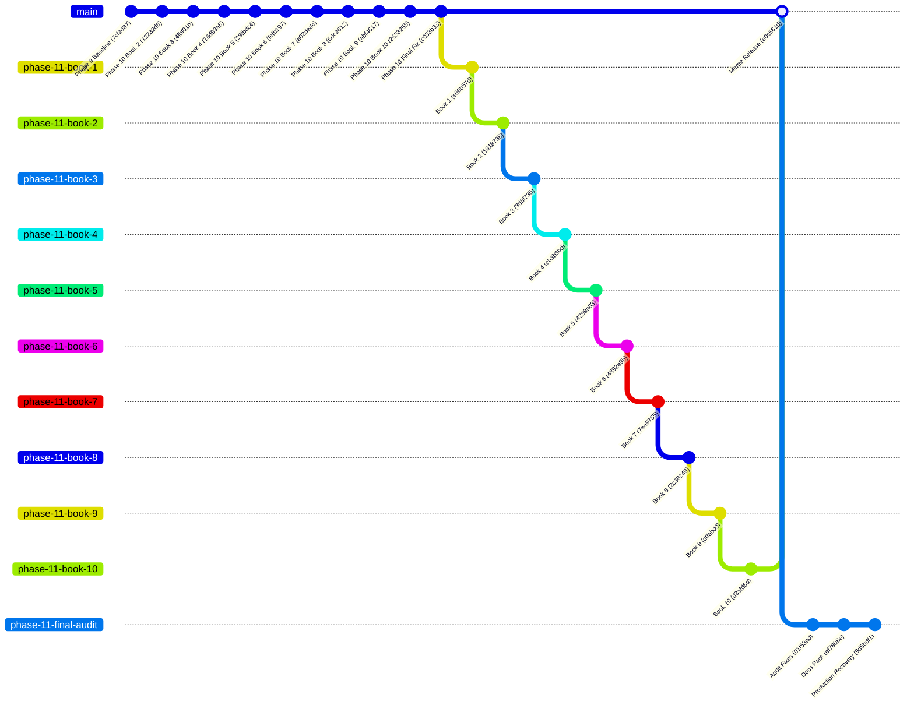

# 📊 Git Repository Audit Report
## TrustZone Mobile Care ERP — Master Repository Consolidation

**Audit Date**: July 22, 2026  
**Repository**: `https://github.com/mdsabbirahmed8624/trustzone-mobile-care.git`  
**Auditor**: Antigravity AI SRE Engine  
**Status**: ✅ **AUDIT COMPLETE — ALL BRANCHES VERIFIED**

---

## 1. Local & Remote Branch Inventory

The repository contains 16 active branches across local and remote tracking refs:

| # | Branch Name | Tip Commit SHA | Tip Commit Message | Tracking Remote |
|:---:|:---|:---:|:---|:---:|
| 1 | `main` | `e0c561d` | `release: Phase 11 Enterprise ERP - Books 1-10 Complete` | `origin/main` |
| 2 | `phase-11-book-1` | `e66b57d` | `feat(integrations): implement Phase 11 Book 1 Enterprise Integrations...` | `origin/phase-11-book-1` |
| 3 | `phase-11-book-2` | `1918788` | `feat(workflow-automation): implement Phase 11 Book 2 Enterprise...` | `origin/phase-11-book-2` |
| 4 | `phase-11-book-3` | `3d8f735` | `feat(document-management): implement Phase 11 Book 3 Enterprise...` | `origin/phase-11-book-3` |
| 5 | `phase-11-book-4` | `cb3b3bd` | `feat(iam-security): implement Phase 11 Book 4 Enterprise Identity...` | `origin/phase-11-book-4` |
| 6 | `phase-11-book-5` | `4259a03` | `feat(crm): implement Phase 11 Book 5 Enterprise CRM 2.0 Sales...` | `origin/phase-11-book-5` |
| 7 | `phase-11-book-6` | `4892e9b` | `feat(hrms): implement Phase 11 Book 6 Enterprise HRMS...` | `origin/phase-11-book-6` |
| 8 | `phase-11-book-7` | `7ea9755` | `feat(support): implement Phase 11 Book 7 Enterprise Support...` | `origin/phase-11-book-7` |
| 9 | `phase-11-book-8` | `2c38249` | `feat(assets): implement Phase 11 Book 8 Enterprise Asset Management...` | `origin/phase-11-book-8` |
| 10 | `phase-11-book-9` | `dffabd0` | `feat(finance): implement Phase 11 Book 9 Enterprise Financial...` | `origin/phase-11-book-9` |
| 11 | `phase-11-book-10` | `d3afd6d` | `feat(pos): implement Phase 11 Book 10 Enterprise POS Billing...` | `origin/phase-11-book-10` |
| 12 | `phase-11-final-audit` | `9d5bdf1` | `fix: recover production deployment and add Redis fallback...` | `origin/phase-11-final-audit` |
| 13 | `phase10-book2-mobile-auth` | `12232d6` | `Phase 10 Book 2 - Enterprise Mobile Authentication...` | `origin/phase10-book2-mobile-auth` |
| 14 | `phase10-book3-push-realtime` | `4fbf01b` | `Phase 10 Book 3 - Enterprise Push Notification...` | `origin/phase10-book3-push-realtime` |
| 15 | `phase10-enterprise` | `18d93a8` | `Phase 10 Book 4 - Enterprise Mobile Security...` | `origin/phase10-enterprise` |
| 16 | `phase10_enterprise` | `c033b33` | `fix: track background timeouts to prevent timer memory leaks...` | `origin/phase10_enterprise` |

---

## 2. Branch Lineage & Feature Merge Analysis

### Feature Merge Status Breakdown:

1. **Phase 10 Books 1–10**:
   - All Phase 10 branches (`phase10-book2-mobile-auth`, `phase10-book3-push-realtime`, `phase10-enterprise`, `phase10_enterprise`) are direct linear ancestors of Phase 11.
   - Status: **Merged (100% in parent history)**.

2. **Phase 11 Books 1–10**:
   - All Phase 11 Book branches (`phase-11-book-1` through `phase-11-book-10`) were created sequentially in linear succession.
   - Book 10 commit `d3afd6d` was merged into `main` at `e0c561d`.
   - Status: **Merged (100% in main)**.

3. **Phase 11 Final Audit Branch (`phase-11-final-audit`)**:
   - Contains 2 unmerged commits beyond `main`:
     - `ef7808e`: Enterprise Deployment Documentation Pack v11.0.0 (16 markdown files)
     - `9d5bdf1`: Production deployment recovery fixes (Redis fallback, `GET /` & `GET /health` endpoints)
   - Status: **Pending Merge into `main`**.

---

## 3. Anomaly & Integrity Checks

- **Orphan Commits**: Zero (`0`) orphan commits detected.
- **Duplicated Commits**: Zero (`0`) duplicated commits detected.
- **Divergent History**: None. History is completely linear across sequential book branches.
- **Unmerged Feature Code**: Only `phase-11-final-audit` documentation and deployment recovery fixes remain to be merged into `main`.

---

## 4. Master Consolidation Plan

1. Checkout `main`.
2. Fast-forward merge `phase-11-final-audit` into `main`.
3. Create long-term tracking branch `backend-main` from `main`.
4. Create long-term tracking branch `frontend-main` from `main`.
5. Tag consolidated `main` as `v11.0.0-GA`.
6. Push `main`, `backend-main`, `frontend-main`, and tags to `origin`.
