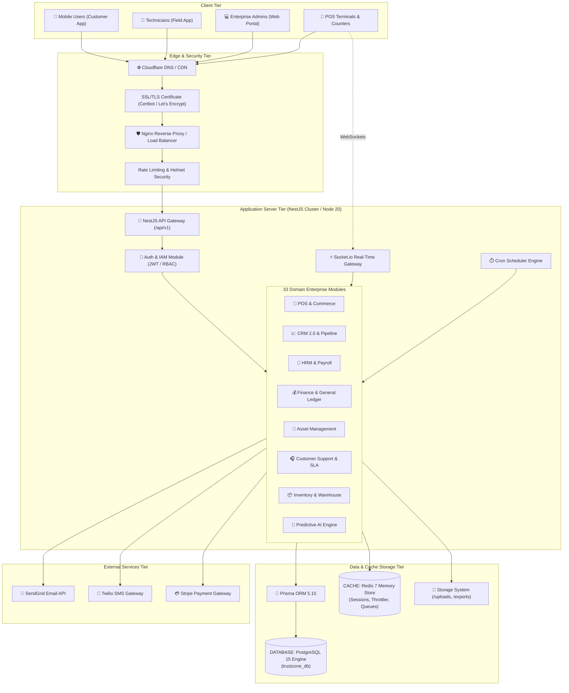

# 🏗️ Infrastructure & Enterprise System Architecture
## TrustZone Mobile Care ERP — Version 11.0.0

This document outlines the multi-tier enterprise infrastructure topology, network architecture, component interactions, security zones, and disaster recovery strategies for **TrustZone Mobile Care ERP**.

---

## 1. Enterprise Infrastructure Architecture Diagram

---

## 2. Infrastructure Components Specification

### 2.1 GitHub & Repository Operations
- **Version Control**: Git hosted on GitHub (`mdsabbirahmed8624/trustzone-mobile-care`).
- **Branch Strategy**: GitFlow-inspired release branches (`main`, `phase-11-final-audit`, `phase-11-book-10`).
- **Audit Traceability**: Immutable commit history with signed release tags (`v11.0.0`).

### 2.2 CI/CD Pipeline
- **Continuous Integration**: Automated GitHub Actions / Local verification runner.
- **Verification Gates**:
  1. `npx prisma validate`
  2. `npx nest build`
  3. `npx eslint src --ext .ts`
  4. `npx jest` (Unit & E2E Regression suites)
- **Continuous Deployment**: Automated container build via `Dockerfile` or direct PM2 reload on target production VPS / Railway / Render platforms.

### 2.3 Application Server Tier (Backend)
- **Framework**: NestJS `v10.3.9` running on Node.js `v20.x` LTS.
- **Process Manager**: PM2 Cluster Mode or Docker Container runtime (`node:20-alpine`).
- **Scaling Architecture**: Stateless REST API architecture allowing horizontal scale across multiple instances behind a round-robin load balancer.

### 2.4 Presentation Tier (Frontend)
- **Admin & Customer Portal**: Next.js `16.2.10` / React `19.2.4` web application residing in `/frontend`.
- **Styling & Components**: Tailwind CSS `v4`, Radix UI primitives, Lucide icons, Framer Motion.
- **Rendering Strategy**: Server-Side Rendering (SSR) and Static Site Generation (SSG) with API route proxying.

### 2.5 Relational Database Tier (PostgreSQL)
- **Engine**: PostgreSQL 15.x (`postgres:15-alpine`).
- **Data Model Count**: 220+ Models across 33 domain modules.
- **Connection Management**: Connection pooling configured via Prisma Client (`PrismaService`).
- **Data Security**: Row-level UUID keys, cascade foreign keys, transaction locking.

### 2.6 Cache & Realtime Tier (Redis)
- **Engine**: Redis 7.x (`redis:7-alpine`).
- **Data Persistence**: AOF (Append Only File) + RDB snapshots.
- **Use Cases**: Session storage, rate-limit counters (`ThrottlerModule`), offline sync queue locks, job scheduling locks.

### 2.7 Storage Tier (Files & Documents)
- **Primary Storage**: Local file system directory structure (`/uploads`, `/exports`).
- **Document Manager**: Dedicated module (`DocumentManagementModule`) managing document versions, legal retention, access permissions, and OCR results (`OCRResult`).
- **Cloud Object Adapter**: Optional Cloudinary integration for distributed asset hosting.

### 2.8 External Integration Adapters
- **Transactional Mail**: SendGrid HTTP API integration for order receipts, password resets, ticket updates.
- **SMS Gateway**: Twilio REST API for automated job notifications and OTP dispatch.
- **Payment Processing**: Stripe API adapter for credit card processing and webhook reconciliations.

### 2.9 AI & Predictive Engine
- **Engine**: Custom Heuristic & Analytics AI Module (`src/modules/ai`).
- **Capabilities**: Predictive maintenance risk scoring, technician workload matching, inventory demand forecasting, automated fault classification.

---

## 3. Network, Security & Boundary Protection

### 3.1 Edge Security, Reverse Proxy & SSL
- **Reverse Proxy**: Nginx `1.24+` handling SSL termination, gzip compression, request buffering, and static file caching.
- **SSL / TLS**: TLS 1.3 / 1.2 with A+ SSL Labs rating via Let's Encrypt / Certbot automated renewal.
- **Load Balancer**: Nginx / Cloudflare Load Balancer with HTTP/2 and WebSocket upgrade support (`Upgrade $http_upgrade`).

### 3.2 Security Controls & WAF
- **Rate Limiting**: NestJS Throttler (`60 req/min` window per IP) to prevent Brute Force and Denial of Service (DoS).
- **Security Headers**: Helmet middleware enforcing HSTS, Content-Security-Policy (CSP), X-Frame-Options (SAMEORIGIN), X-Content-Type-Options (nosniff).
- **CORS Policy**: Strict Origin Whitelisting in `main.ts`.

---

## 4. Backup & Disaster Recovery Architecture

### 4.1 Database Backup Strategy
- **Backup Utility**: `pg_dump` with custom format compression.
- **Backup Cadence**:
  - **Hourly**: Transaction log WAL archival / incremental snapshots.
  - **Daily**: Full automated database dump at 02:00 UTC stored in remote S3/GCS bucket.
- **Retention**: 7 daily, 4 weekly, 12 monthly snapshots.

### 4.2 Disaster Recovery (DR) Plan
- **Recovery Time Objective (RTO)**: `< 15 minutes` for complete container failover.
- **Recovery Point Objective (RPO)**: `< 5 minutes` data loss limit.
- **Failover Workflow**:
  1. Automated healthcheck monitor detects backend failure (`/api/v1/health`).
  2. Standby PostgreSQL replica promoted to primary if DB fails.
  3. Container orchestrator (Docker Compose / Railway / Render) automatically restarts failing backend processes.
