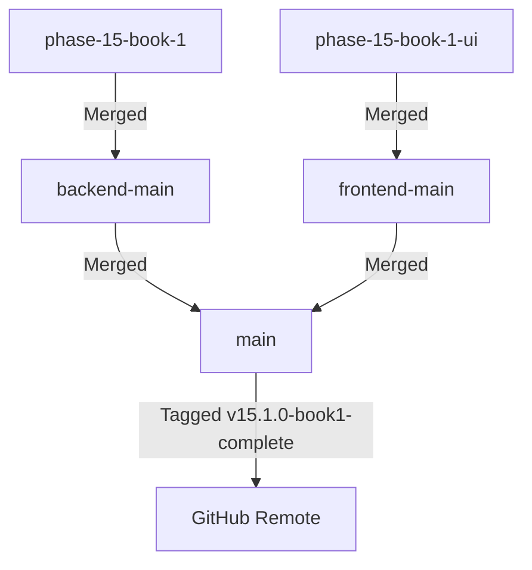

# 🔀 Phase 15 Book 1 — Merge Report
## Feature Branch Integration & Git Synchronization

**Phase**: 15  
**Book**: 1  
**Date**: July 27, 2026  
**Status**: ✅ **MERGE COMPLETE & SYNCHRONIZED**

---

## 1. Branch Integration Flow

---

## 2. Synchronization Details

- **Backend Branch**: `phase-15-book-1` merged into `backend-main` (`f01205a`).
- **Frontend Branch**: `phase-15-book-1-ui` merged into `frontend-main` (`f01205a`).
- **Production Main**: Both branches fast-forwarded into `main` (`f01205a`).
- **Release Tag**: `v15.1.0-book1-complete` annotated and created on commit `f01205a`.
- **Remote Synchronization**: Pushed to `https://github.com/mdsabbirahmed8624/trustzone-mobile-care.git`.
