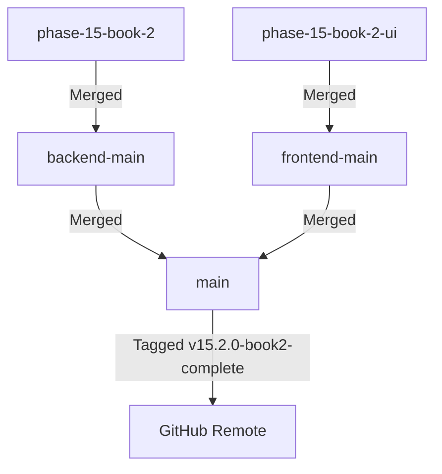

# 🔀 Phase 15 Book 2 — Merge Report
## Feature Branch Integration & Git Synchronization

**Phase**: 15  
**Book**: 2  
**Date**: July 27, 2026  
**Status**: ✅ **MERGE COMPLETE & SYNCHRONIZED**

---

## 1. Branch Integration Architecture

---

## 2. Git Synchronization Log

- **Backend Branch**: `phase-15-book-2` merged into `backend-main` (`b96d4c0`).
- **Frontend Branch**: `phase-15-book-2-ui` merged into `frontend-main` (`b96d4c0`).
- **Production Main**: Fast-forwarded both branches into `main` (`b96d4c0`).
- **Release Tag**: `v15.2.0-book2-complete` annotated and created on commit `b96d4c0`.
- **Remote Sync**: Synchronized with `https://github.com/mdsabbirahmed8624/trustzone-mobile-care.git`.
