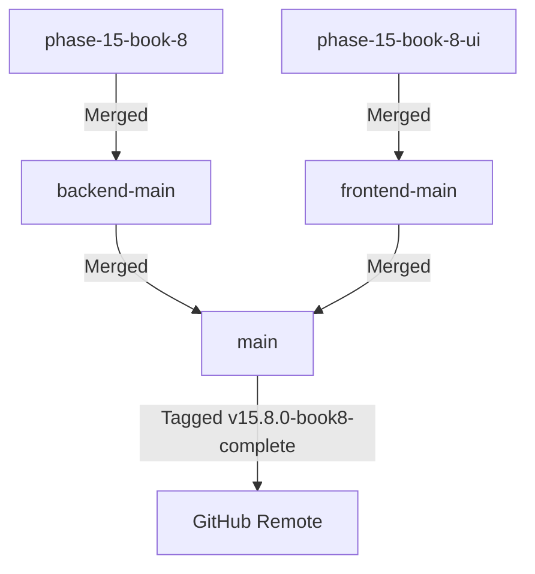

# 🔀 Phase 15 Book 8 — Merge Report
## Feature Branch Integration & Git Synchronization

**Phase**: 15  
**Book**: 8  
**Date**: July 28, 2026  
**Status**: ✅ **MERGE COMPLETE & SYNCHRONIZED**

---

## 1. Branch Integration Architecture

---

## 2. Git Synchronization Log

- **Backend Branch**: `phase-15-book-8` merged into `backend-main` (`b88cac2`).
- **Frontend Branch**: `phase-15-book-8-ui` merged into `frontend-main` (`b88cac2`).
- **Production Main**: Fast-forwarded both branches into `main` (`b88cac2`).
- **Release Tag**: `v15.8.0-book8-complete` annotated and created on commit `b88cac2`.
- **Remote Sync**: Synchronized with `https://github.com/mdsabbirahmed8624/trustzone-mobile-care.git`.
